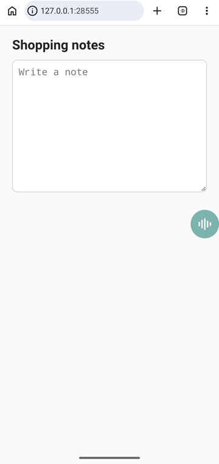
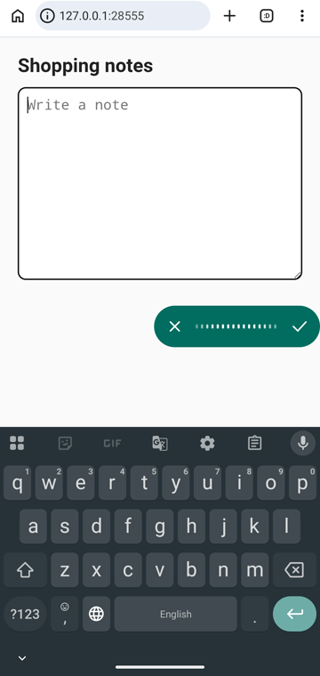
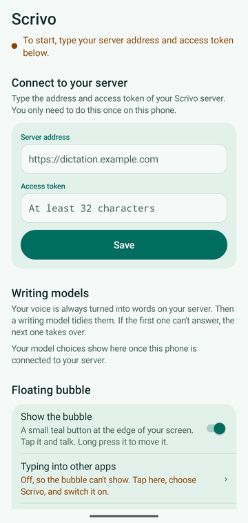

# Scrivo

**Speak, and it's written.** A free, open-source, self-hosted **Wispr Flow alternative**: Whisper-powered voice typing and AI dictation for Android and Windows. Tap a floating teal bubble on your phone, or hold
Ctrl+Windows on your computer, speak, and tidy text lands where your cursor is. Speech is
recognized on your own server; the tidy-up is done by any model you choose, local by default.

Looking for an open-source Wispr Flow clone (often searched as "Whisper Flow"), a free alternative to paid dictation apps, a private speech-to-text keyboard, or offline voice dictation you can run on your own computer? That is what Scrivo is.

Scrivo is an independent project inspired by the experience of Wispr Flow. It is not
affiliated with Wispr Flow or its makers. See [CREDITS.md](CREDITS.md).

<p>
  
  
  
</p>

*The bubble over any app, the speaking bar while you talk, and the first screen. Pictures from a
test phone with made-up data.*

## What you get

- **A server you run yourself** (tested on Linux; needs Python 3.11 or newer). It hears speech with
  local [Whisper](https://github.com/openai/whisper) models through
  [faster-whisper](https://github.com/SYSTRAN/faster-whisper), and sends the recognized words to
  your chosen writing model to remove filler words, apply spoken corrections and punctuate.
- **Android app** (Android 11 or newer): a floating bubble over any app. Tap it to start, tap the
  check to finish, the X to throw it away. Long-press to move it. Words go into the text box that
  has the cursor; with no text box selected they are copied to the clipboard.
- **Windows client**: hold Ctrl+Windows and speak, let go to finish; or tap Ctrl+Windows to start
  hands-free and tap again to finish. Esc cancels. Ctrl+Alt+Space works too. A tiny see-through
  teal bar waits at the bottom of the screen and grows into the speaking bar while you talk.
- **Your choice of writing model**: any OpenAI-compatible chat endpoint (Ollama, llama.cpp,
  vLLM, LM Studio, or a cloud service). Pick a primary and two backups in the phone's settings.
  Cloud choices show a clear notice first, because they send your words off your machine.
- **Nothing lost**: three ordered backups for recognition and for writing. If every writing model
  fails you still get your words exactly as heard, and recordings are kept on the server so a
  failed dictation can be retried.
- **One dictionary** of names and words spelled your way, shared by every device.

## 1. Run the server

```bash
git clone https://github.com/dugmaclean/scrivo.git
cd scrivo
python3 -m venv .venv
. .venv/bin/activate
pip install -r requirements.txt

# A private access token (32+ characters), readable only by you.
mkdir -p ~/.config/scrivo
python3 -c "import secrets; print(secrets.token_urlsafe(48))" > ~/.config/scrivo/token
chmod 600 ~/.config/scrivo/token

# Writing models: start from the example and keep the ones you use.
cp scrivo.example.json scrivo.json

DICTATION_TOKEN_FILE=~/.config/scrivo/token python3 server.py
```

The server listens on `127.0.0.1:8791`. The first dictation downloads the speech models (about
500 megabytes for `small.en`); after that everything runs offline.

**A writing model.** The example settings expect [Ollama](https://ollama.com) on the same
machine. Install it and run `ollama pull qwen2.5:7b-instruct` (about 4.7 gigabytes), or change
the first entry in `scrivo.json` to any OpenAI-compatible endpoint you already have, such as
a [llama.cpp](https://github.com/ggml-org/llama.cpp) server. With no writing model reachable,
Scrivo still works and gives you the words as heard.

Pick a model of about 7 billion parameters or larger. In our tests a stock 7B model tidied each
sentence in one to two seconds on an ordinary 16-core processor, with no graphics card, and kept
the meaning. A 3B model was faster but changed meaning: it turned "Can you remind me to call the
dentist" into "Call the dentist", and answered a request instead of writing it down. Scrivo
refuses a reply that leaves out most of what you said and gives you your words as heard
instead, but a bigger model avoids the problem.

**Cloud models (optional).** Cloud entries name an environment variable for their key
(`"api_key_env": "OPENAI_API_KEY"`), so keys never go in the settings file. Set the variable
before starting the server. A cloud model can only be picked after its privacy notice is shown.

**Reaching it from your phone.** Phones need an `https://` address. Put the server behind any
HTTPS reverse proxy you trust, for example [Caddy](https://caddyserver.com) on your own domain,
or a private network such as [Tailscale](https://tailscale.com) with `tailscale serve`. Do not
expose port 8791 to the internet without HTTPS. Every request needs the token.

### Server settings

| Setting | Default | What it does |
|---|---|---|
| `DICTATION_TOKEN_FILE` | (required, or `DICTATION_TOKEN`) | Owner-only file holding the access token |
| `DICTATION_BIND` / `DICTATION_PORT` | `127.0.0.1` / `8791` | Where the server listens |
| `DICTATION_STATE` | `state` | Folder for the saved words, settings and recordings |
| `SCRIVO_CONFIG` | `scrivo.json` | The writing models file |
| `SCRIVO_RECOGNITION` | `small.en,small,tiny.en` | Up to three speech models, first to last |
| `SCRIVO_OFFLINE` | off | `1` means never download models; use only cached ones |
| `SCRIVO_MAX_STORED_GB` | `20` | Storage cap for kept recordings |
| `DICTATION_CUDA_LIBRARIES` | `~/.local/share/scrivo/cuda` | Folder with cuBLAS 12 and cuDNN 9 to run speech on an NVIDIA card |
| `DICTATION_ALWAYS_WRITE` | off | `1` sends every sentence to the writing model, even plain ones |

## 2. Install the Android app

Open the `android` folder in Android Studio and run it on your phone. Or build it from the
command line with a JDK 17 and the Android SDK (platform 34); the Gradle wrapper downloads
everything else:

```bash
cd android
export ANDROID_HOME=~/Android/Sdk      # wherever your Android SDK is
./gradlew assembleDebug
adb install app/build/outputs/apk/debug/app-debug.apk
```

Then on the phone:

1. Open Scrivo, go to **Settings**, and enter your server address (`https://...`) and token.
2. Turn on Scrivo under **Accessibility** (Android settings) so it can put words in the text
   box that has the cursor. Scrivo never reads or types into password fields.
3. Allow **Display over other apps** and the **microphone** when asked.

The teal bubble now floats over your apps. Tap it, speak, tap the check.

## 3. Install the Windows client

The Windows client uses only Python's standard library (Python 3.11 or newer from python.org).

1. Copy the `windows` folder anywhere, for example `%LOCALAPPDATA%\Scrivo\app`.
2. Create `%APPDATA%\Scrivo\config.json`:

   ```json
   {"endpoint": "https://your-server.example", "token": "your-access-token"}
   ```

   Notepad is fine for this file.
3. Run `pythonw scrivo.pyw`. To start it at sign-in, put a shortcut to that command in your
   Startup folder (`Win+R`, then `shell:startup`).

Hold Ctrl+Windows, speak and let go. A small teal icon by the clock names the keys and offers
Quit. If another dictation app that also uses Ctrl+Windows is open, Scrivo leaves that key to
it and answers Ctrl+Alt+Space instead, so nothing is ever typed twice.

## Privacy

- Speech is recognized on your server. Recordings stay there.
- With local writing models, your words never leave your own computers.
- A cloud writing model receives only the recognized words, never the recording, and only after
  you pick it past its notice.
- The server's logs and the Windows log hold states and timings, never your words.

## Tests

```bash
python3 -m unittest discover -s tests
```

`tools/check_text_target.py` runs the phone app's text-box logic against stand-in Android
classes, and `tools/check_android.py` compiles the app's resources and Java (it needs
`ANDROID_HOME` and a JDK 17).

## License

MIT. See [LICENSE](LICENSE). Credits for the projects and software Scrivo builds on are in
[CREDITS.md](CREDITS.md).
